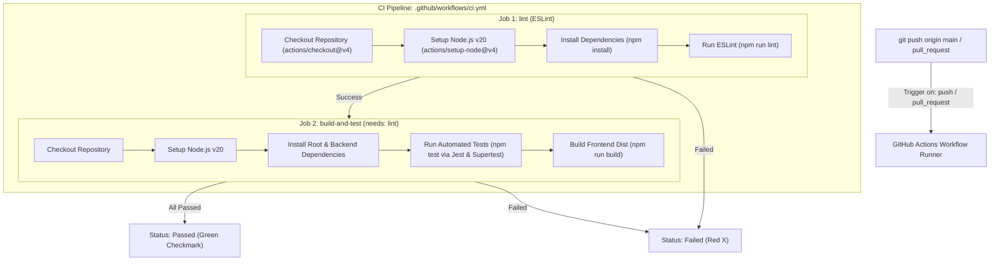

# Practical 12: CI/CD Pipeline with GitHub Actions

**CO / PO:** CO5 / PO3, PO5  
**Objective:** To automate testing and deployment of the application using a CI/CD pipeline.

---

## 1. Architecture & Pipeline Flow



---

## 2. Implemented Deliverables

| Deliverable | Location | Description |
| :--- | :--- | :--- |
| **CI Workflow File** | `.github/workflows/ci.yml` | Multi-job workflow with linting and automated build & test stages. |
| **Test Suite** | `backend/tests/tasks.test.js` | Automated API test suite testing `/health` and `/tasks` with Supertest and Jest. |
| **Server Refactoring** | `backend/server.js` | Exported `app` instance and conditional listening (`require.main === module`) for test isolation. |
| **Root & Backend Scripts** | `package.json`, `backend/package.json` | Configured `npm test` and `npm run lint`. |
| **Linting Configuration** | `eslint.config.js` | Configured rules and directory ignores for clean frontend linting. |
| **Status Badge** | `README.md` | Added GitHub Actions live workflow status badge. |

---

## 3. GitHub Actions Workflow (`.github/workflows/ci.yml`)

```yaml
name: CI Pipeline

on:
  push:
    branches: [main, master]
  pull_request:
    branches: [main, master]

jobs:
  lint:
    name: Code Linting (ESLint)
    runs-on: ubuntu-latest
    steps:
      - name: Checkout Code
        uses: actions/checkout@v4

      - name: Set up Node.js
        uses: actions/setup-node@v4
        with:
          node-version: 20
          cache: 'npm'

      - name: Install Root Dependencies
        run: npm ci || npm install

      - name: Run ESLint
        run: npm run lint

  build-and-test:
    name: Build & Automated Tests
    needs: [lint]
    runs-on: ubuntu-latest
    steps:
      - name: Checkout Code
        uses: actions/checkout@v4

      - name: Set up Node.js
        uses: actions/setup-node@v4
        with:
          node-version: 20
          cache: 'npm'

      - name: Install Root Dependencies
        run: npm ci || npm install

      - name: Install Backend Dependencies
        working-directory: backend
        run: npm ci || npm install

      - name: Run Automated Tests
        run: npm test

      - name: Build Frontend Production Dist
        run: npm run build
```

---

## 4. Automated Tests (`backend/tests/tasks.test.js`)

```javascript
const request = require("supertest");
const app = require("../server");
const Task = require("../models/Task");

describe("Task Management API Tests", () => {
    afterEach(() => {
        jest.restoreAllMocks();
    });

    test("GET /health returns 200 and OK status", async () => {
        const res = await request(app).get("/health");
        expect(res.statusCode).toBe(200);
        expect(res.body.status).toBe("OK");
    });

    test("GET /tasks returns 200", async () => {
        jest.spyOn(Task, "find").mockReturnValue({
            sort: jest.fn().mockResolvedValue([
                { _id: "1", title: "Test CI/CD Task", completed: false, priority: "medium" }
            ])
        });

        const res = await request(app).get("/tasks");
        expect(res.statusCode).toBe(200);
        expect(Array.isArray(res.body)).toBe(true);
    });
});
```

---

## 5. Key Questions & Theoretical Analysis

### Q1: What is the difference between Continuous Integration (CI) and Continuous Deployment (CD), and which one does this practical demonstrate?
> **Answer:**  
> - **Continuous Integration (CI):** The practice of frequently merging code changes into a central repository, followed by automated builds, linting, and automated tests. The goal is to detect and address bugs early in the development lifecycle.
> - **Continuous Deployment (CD):** The automated process of releasing every passing build directly to staging or production environments (e.g., deploying Docker containers to AWS, Render, or a Kubernetes cluster) without manual intervention.
> - **Demonstrated in this Practical:** This practical specifically demonstrates **Continuous Integration (CI)**, as it automatically checks out code, installs dependencies, runs linters, and executes test suites on every `git push`, reporting pass/fail status without performing production deployments.

---

### Q2: Why does running tests automatically on every push catch problems earlier than testing manually before a release?
> **Answer:**  
> 1. **Immediate Feedback Loop:** Developers receive failure notices within minutes of pushing code, when the exact logic changes are fresh in their mind.
> 2. **Prevents Broken Code Accumulation:** If testing is delayed until the end of a sprint, multiple developers may have built upon a flawed component, leading to complex debugging and costly merge conflicts.
> 3. **Consistency & Human Error Elimination:** Manual testing is prone to oversight, fatigue, and missed edge cases. CI runs the exact same test sequence under clean, containerized environments every single time.

---

### Q3: What would happen to the pipeline if the test file path were incorrect — would the workflow fail at the same step as a genuine test failure?
> **Answer:**  
> - **Yes, it will fail at the `run: npm test` step**, but the root cause and error message will differ significantly:
>   - **Genuine test failure:** Jest finds the file, runs assertions, and fails on `expect(res.statusCode).toBe(200)` with a detailed assertion diff showing received vs expected values.
>   - **Incorrect file path:** Jest reports `No tests found related to files matching ...` or `Pattern did not match any file` and exits with an error code, failing before any assertions execute.

---

## 6. How to Demonstrate Pass and Deliberate Fail

### Step A: Push to GitHub & See Initial Green Run
```bash
git add .
git commit -m "feat: setup CI pipeline with GitHub Actions"
git branch -M main
git remote add origin https://github.com/<YOUR_USERNAME>/<YOUR_REPO>.git
git push -u origin main
```
*Go to the **Actions** tab on GitHub: observe the pipeline run and finish with a **Green checkmark**.*

---

### Step B: Deliberately Break the Test (Step 5 of Lab Manual)
In `backend/tests/tasks.test.js`, edit line 13:
```javascript
// Change 200 to 500 to simulate a deliberate failure
expect(res.statusCode).toBe(500);
```
Commit and push:
```bash
git add backend/tests/tasks.test.js
git commit -m "test: deliberately break test to verify CI failure"
git push
```
*Go to the **Actions** tab on GitHub: observe the job fail with a **Red X** and view the assertion failure in the logs.*

---

### Step C: Fix the Test and Observe Pipeline Turn Green (Step 6 of Lab Manual)
Revert line 13 back to `200`:
```javascript
expect(res.statusCode).toBe(200);
```
Commit and push:
```bash
git add backend/tests/tasks.test.js
git commit -m "fix: correct test expectation to 200"
git push
```
*Observe the **Actions** tab turn **Green** again!*

---

## 7. Screenshots Required for Word Report

1. **Local Test Run (`npm test`):** PowerShell showing Jest passing both tests.
2. **Local Lint Run (`npm run lint`):** PowerShell showing ESLint executing with zero errors.
3. **GitHub Actions Workflow File:** VS Code displaying `.github/workflows/ci.yml`.
4. **GitHub Actions Dashboard (Passed Run):** Green checkmark on GitHub.
5. **GitHub Actions Dashboard (Failed Run):** Red X demonstrating deliberate failure on step `npm test`.
6. **Detailed Log of Failed Assertion:** GitHub log showing `Expected: 500, Received: 200`.
7. **README with Live Status Badge:** GitHub repository home showing `passing` status badge.
